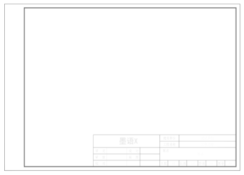
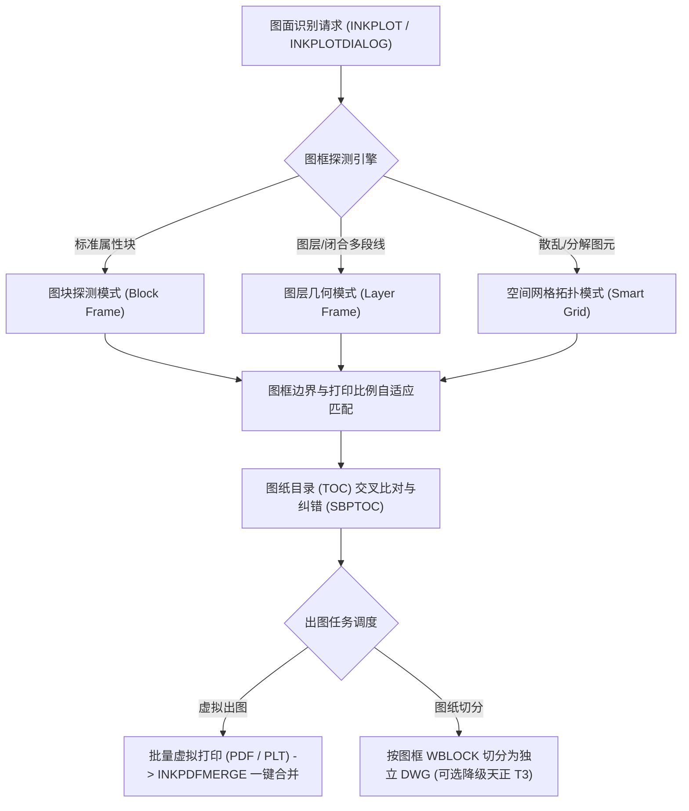
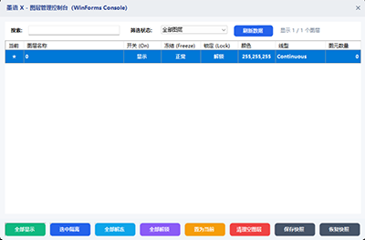
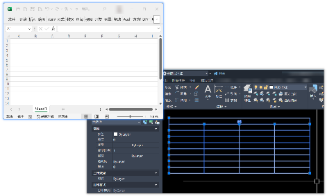
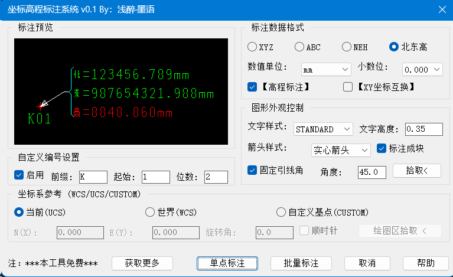
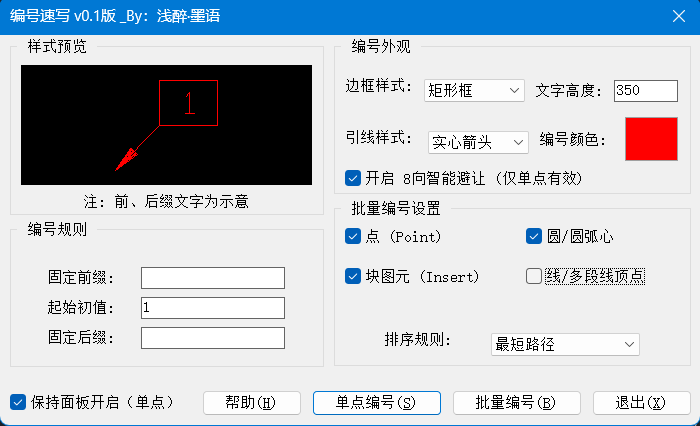
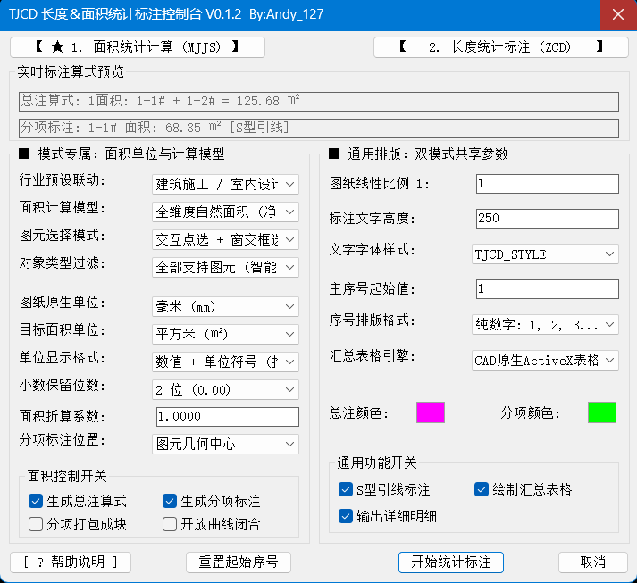
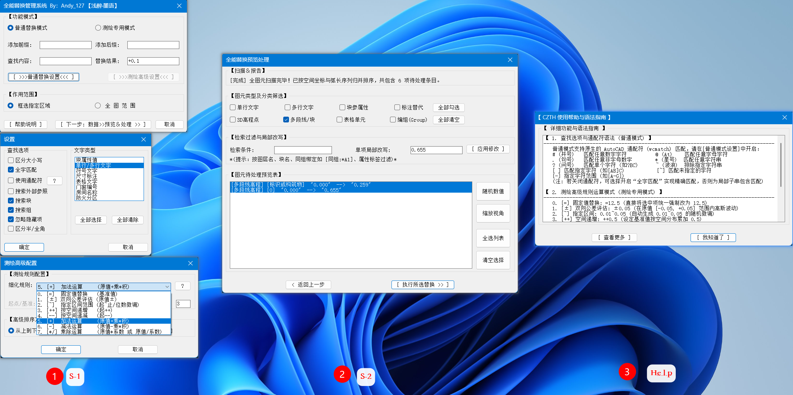
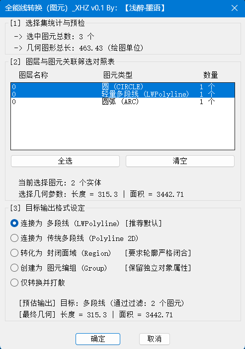
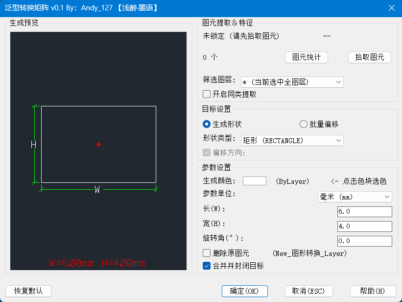

<a id="readme-top"></a>

<div align="center">

# 墨语 X (InkVerse X)

<p align="center"><strong>面向工程设计、规划测绘与施工制图的 AutoCAD 实用效率工具集</strong><br><em>作者个人独立开发与维护 · 基于 C# 托管程序集与 AutoLISP/VLX 实用工具库 · 100% AutoCAD 原生实体 · 零第三方代理对象</em></p>

<p align="center"><a href="https://github.com/Andyang127/InkVerseX/releases"></a><a href="https://github.com/Andyang127/InkVerseX"></a><a href="https://github.com/Andyang127/InkVerseX"></a><a href="https://github.com/Andyang127/InkVerseX"></a><a href="https://github.com/Andyang127/InkVerseX"></a><a href="LICENSE"></a><a href="https://github.com/Andyang127/InkVerseX"></a><a href="https://github.com/Andyang127/InkVerseX"></a><a href="https://andyang127.github.io/InkVerseX/"></a></p>

<p align="center"><a href="https://github.com/Andyang127/InkVerseX/releases"><strong>最新安装包下载</strong></a> | <a href="https://andyang127.github.io/InkVerseX/"><strong>在线使用手册</strong></a> | <a href="#3-版本更新日志"><strong>版本日志 (v0.1.5)</strong></a> | <a href="#2-核心架构与技术特点"><strong>核心架构</strong></a> | <a href="#6-c-核心原生模块详细说明"><strong>C# 模块详解</strong></a> | <a href="#7-autolisp--vlx-扩展工具库说明"><strong>VLX 工具详解</strong></a> | <a href="#8-常见问题排查-faq"><strong>常见问题 (FAQ)</strong></a> | <a href="#10-技术支持与联系"><strong>支持与反馈</strong></a></p>

</div>

---

| 核心属性项 | 配置规范与支持指标 | 技术说明 |
|:---|:---|:---|
| **套件主版本** | `v0.1.5` | 正式发布版 |
| **支持平台** | AutoCAD 2007 ~ 2019 (32/64 位双架构兼容) <br> AutoCAD 2020 ~ 2027 (原生 64 位体系) | 覆盖 10 个主版本世代 (R17~R26) |
| **运行框架** | .NET Framework 3.5 ~ 4.8 (经典运行时) <br> .NET 8.0 ~ 10.0 (现代 CoreCLR 独立运行时) | 多目标运行时自适应感知加载 |
| **底层架构** | C# 托管程序集核心驱动 + AutoLISP / VLX 扩展算法库 | 双引擎解耦协同架构 |
| **图元规范** | 100% AutoCAD 原生实体 (`BlockReference`, `Polyline`, `DBText`, `MText`, `Table`) | 零第三方自定义代理实体，脱离插件完全可读可测 |
| **作品性质** | 个人业余独立开发作品 | 个人开源探索项目，非公司或集体商业产品 |

---

## 安装包下载与说明

<div style="background-color: #F8FAFC; border: 1px solid #CBD5E1; border-left: 5px solid #0284C7; padding: 16px 20px; border-radius: 6px; margin: 18px 0; line-height: 1.7;">
<div style="margin-bottom: 8px;">
<span style="background-color: #0284C7; color: #FFFFFF; font-size: 12px; font-weight: bold; padding: 2px 7px; border-radius: 3px; vertical-align: middle;">作者说明</span>
<span style="color: #0F172A; font-size: 15px; font-weight: bold; margin-left: 8px; vertical-align: middle;">关于本项目为个人作品与开源规划的说明</span>
</div>
<p style="margin: 0 0 8px 0; color: #334155; font-size: 13.5px;">墨语 X (InkVerse X) 是作者（浅醉·墨语 / Andy_127）业余结合一线工程设计、测绘深化与现场制图的实际经验独立开发与维护的个人项目。本仓库当前主要发布<strong>编译测试就绪的安装包、离线手册与开源文档</strong>。暂未开放全部完整工程源码主要基于以下实际情况：</p>
<div style="color: #475569; font-size: 13px;">
<p style="margin: 4px 0;"><strong>1. 个人代码清理与解耦：</strong>早期工程包含个人本地开发路径与专用调试桩，作者正利用业余时间系统性整理排版与环境解耦；</p>
<p style="margin: 4px 0;"><strong>2. 跨 10 世代编译依赖庞大：</strong>深度适配 AutoCAD 2007 ~ 2027（R17~R26 多运行时）需本地配置庞大的 ObjectARX SDK 与运行库。为避免因环境缺失产生大量编译报错，现阶段优先分发全数测试通过的安装程序，确保各位同行直接安装即可稳定使用；</p>
<p style="margin: 4px 0;"><strong>3. 防范恶意篡改与倒卖：</strong>避免部分灰产渠道抹去署名或植入广告弹窗进行倒卖，保障一线图纸环境纯净与系统安全；</p>
<p style="margin: 4px 0;"><strong>4. 后续分批开放计划：</strong>将按<strong>“独立轻量算法 -> 常用工具模块（输入法/图层） -> 整体工程框架”</strong>成熟一个推送一个。欢迎在 Issues 提出宝贵的修改建议！</p>
</div>
</div>

- **最新安装包发布页面**：[前往 GitHub Releases 页面下载安装包](https://github.com/Andyang127/InkVerseX/releases)
- **墨语 X 在线交互手册**：[墨语 X 使用说明 (GitHub Pages)](https://andyang127.github.io/InkVerseX/)
- **本地离线手册查阅**：下载/克隆仓库至本地后，直接双击同级 `Readme.html` 打开；或在 AutoCAD 命令行输入 <kbd>INKHELP</kbd> 自动唤起。

### 套件安装与部署步骤

1. 从 Release 页面下载 `InkVerseX_Setup_v0.1.5.exe`；
2. 退出当前运行的 AutoCAD 进程，双击运行安装向导；
3. 根据向导提示选择需要挂载的 AutoCAD 版本（支持 AutoCAD 2007 ~ 2027 多版本共存并独立勾选）；
4. 点击“安装”直至完成；
5. 启动对应版本 AutoCAD，系统将自动加载核心程序集，并生成顶部下拉菜单 (`墨语 X(&X)`)、功能区 Ribbon 选项卡与经典快捷工具栏。

- **独立功能模块单独安装**：若仅需使用某项单一功能（例如仅需图层管理或仅需批量打印），可直接使用各子分支生成的独立安装包（如 `CadAutoBpFrame_Setup_v0.1.0.exe`、`CadAutoBatchPrint_Setup_v0.1.0.exe`、`CadAutoIme_Setup_v0.4.4.exe` 等）；每个独立插件均具备独立安装向导，自动配置独立启动注册表，互不干扰。
- **自动挂载与受信任路径**：安装向导会自动写入当前用户的 AutoCAD 注册表启动配置（`LOADCTRLS = 2`, `MANAGED = 1`），并自动添加安装路径到受信任位置 (`TRUSTEDPATHS`)，避免启动弹出未签名警告。

---

## 1. 项目概述

墨语 X (InkVerse X) 是一套面向工程设计、建筑施工、市政规划与地理测绘领域的 AutoCAD 辅助制图实用插件集。

本套件采用模块化分层解耦架构：

1. **宿主引导程序 (`InkVerseX.dll`)**：在 AutoCAD 启动时自动初始化，负责依赖程序集解析 (`AssemblyResolve`)、按需动态扫描加载各业务子插件，并统一构建维护顶部下拉菜单、功能区 (Ribbon) 选项卡与快捷工具栏；
2. **8 个 C# 原生独立功能模块**：各模块在物理上为独立子工程，具备独立编译与单独运行能力，涵盖智能图框排版、图纸批量打印与切图、输入法智能感知、图层点选控制、表格数据提取、视口截图导出、图纸数据库深度清理与 LISP 集中管控；
3. **7 个 AutoLISP / VLX 实用扩展工具**：覆盖修订云线批注、坐标高程标注、编号速写、线长测量、文本数值替换、线元清洗转换与几何图形重构。

> [!NOTE]
> **原生图元安全准则**：所有功能均基于 AutoCAD 官方提供的 .NET API 与 ObjectARX 接口实现，图纸中生成的所有图元均为 AutoCAD 原生对象 (`BlockReference`, `Polyline`, `DBText`, `MText`, `Table`)，不依赖任何第三方自定义实体 (Proxy Entity)。在未安装本插件的纯净 AutoCAD 环境中打开图纸，所有图元内容均可正常查阅、测量、编辑与出图。

---

## 2. 核心架构与技术特点

```mermaid
graph LR        
    subgraph Host["宿主引导装配层 (InkVerseX.dll)"]        
        AR["程序集解析器<br>AssemblyResolve"]        
        DS["动态插件扫描引擎<br>Dynamic Loader"]        
        UI["统一界面挂载<br>Ribbon / Menu / Toolbar"]        
    end        
        
    subgraph CSharp["8 大 C# 核心原生托管模块"]        
        M1["BP_Frame 智能图框"]        
        M2["BatchPrint 批量打印切图"]        
        M3["Auto IME 输入法感知"]        
        M4["LayerManager 图层控制"]        
        M5["LiveTable 表格提取"]        
        M6["SNAP 视口截图"]        
        M7["SmartClean 数据库清理"]        
        M8["VlxSuite 脚本管理"]        
    end        
        
    subgraph VLX["7 大 AutoLISP / VLX 实用工具库"]
        V0["XDYX 修订云线批注"]        
        V1["ZBBZ 坐标高程"]        
        V2["BHSX 智能编号"]        
        V3["TJCD 长度＆面积统计"]        
        V4["CZTH 文本数值替换"]        
        V5["XZH 线清洗转换"]        
        V6["XZX 图元重构矩阵"]        
    end        
        
    AR --> DS        
    DS --> CSharp        
    DS --> VLX        
    CSharp & VLX --> UI
```

### 2.1 C# + VLX 双引擎协同机制
- **C# 托管内核**：负责处理图形计算几何、空间拓扑索引、WPF 自适应界面、系统底层输入法感知与高分辨率位图渲染；
- **VLX 实用算法库**：封装经典的制图算法，通过内置沙盒机制安全调用，兼顾执行速度与即用即走的灵活性。

### 2.2 集中共享运行资产机制 (Shared Component)
- 采用集中共享资产架构，将非托管渲染核心（`pdfium.dll`）、VLX 脚本库与全局高分辨率图标资源统一归置于安装目录下的 `Shared` 文件夹；
- 各 CAD 世代专用目录（R17 ~ R26）仅存放版本专用的托管 DLL，杜绝多世代重复打包造成的磁盘冗余，大幅缩减安装包体积与内存占用。

### 2.3 外部项目源码零副本联动 (MSBuild Shared Source)
- 各独立子工程（如 `CAD Auto IME`、`CAD Auto SNAP`、`CAD Auto BP_Frame` 等）与墨语 X 宿主工程之间，采用 MSBuild 共享源码项目直接链接模式；
- 在保持各子工程完全独立维护与单独发布的前提下，主工程修改代码后可直接跨世代联动编译，无需手动复制 DLL 副本。

### 2.4 全世代自适应双主题系统
- **AutoCAD 2007 ~ 2014**：自动适配浅色白底商务主题，消除旧版本 CAD 界面中深色弹窗带来的视觉突兀感；
- **AutoCAD 2015 ~ 2027**：动态监听 AutoCAD 的 `COLORTHEME` 系统变量，跟随 CAD 宿主界面的明暗主题切换无缝换肤；
- **5px 极窄滚动条统一**：全套 C# 插件控制台与停靠面板统一升级为 5px 极窄圆角滑动条 (`SlimScrollViewer`)，最大化绘图区视口空间。

### 2.5 在线检测升级与版本管理
- 集成基于 GitHub Releases API 与静态 `version.json` 的后台异步升级检测机制；
- 支持自适应深浅主题的升级提醒界面，并提供特定版本忽略控制选项。

### 2.6 空间拓扑图框识别与批量虚拟打印引擎
- **多源智能图框探测拓扑**：针对工程总图中图签格式混杂、非标图框繁多的痛点，构建了图块属性模式 (BlockFrame)、图层闭合多段线模式 (LayerFrame) 与抗噪空间网格拓扑采样模式 (SmartGrid) 三重识别体系，支持自动捕捉全图图框范围与打印比例；
- **DWG 独立切图与版本降转管线**：提供图元裁剪切分管线，依据图框空间范围执行局部 `WBLOCK` 裁切为独立单张 DWG 文件，支持直接降级保存为天正建筑 T3 (AutoCAD 2004 DWG) 格式，便于施工与审图交付；
- **虚拟打印与多页 PDF 合并集成**：深度集成 PDF 渲染与虚拟打印队列，支持图幅纸张自适应匹配、图纸目录 (TOC) 双向交叉核验，并提供 <kbd>INKPDFMERGE</kbd> 将多份单页 PDF 合并为单份完整工程图册。

---

## 3. 版本更新日志

### 3.1 当前版本 (v0.1.5)

<div align="center">

<br><sub>墨语 X 工具箱控制台 (v0.1.5) · 统一控制台与插件管理界面</sub>
</div>

> **本期版本更新概要**：本次 v0.1.5 更新聚焦于实际制图细节体验修复与核心实用插件扩充，正式新增了 **XDYX 修订云线批注系统 (v0.1)**，并将原有的线长统计与新增的面积计算深度合并升级为 **TJCD 长度＆面积综合统计控制台 (v0.1.2)**，同时对工作空间切换时的 COM 菜单异常与 VLX 运行沙盒进行了全面加固。

- **1. 新增：XDYX 修订云线与工程批注系统 (v0.1)**：
  - **正式入列核心算法库**：将【修订云线_xdyx_v0.1】.VLX 纳入墨语 X 实用工具库与 LISP 插件管理平台，提供专业图纸校审、修改交底与出图批注全流程工具；
  - **动态拖拽与重叠布尔合并**：键入 <kbd>XDYX</kbd> 或 <kbd>XRC</kbd> 呼出参数面板，支持动态拖拽绘制。框选多个重叠区域时，系统底层自动调用 `acUnion` 面域布尔合并为单一大云线；离散独立区域自动生成多对一折线引线汇聚至同一托底基线；
  - **分层托底基线与修订正三角 (△)**：批注文字置于基线上方，日期与校审人置于基线下方，引线拐角处自动生成正等边修订三角 △ 并嵌入版本编号，基线贯穿托底，杜绝文字穿刺与转义混淆；
  - **多样化绘图分支与辅助指令**：提供徒手裸画模式 (<kbd>DRC</kbd>)、文字自适应提取包围盒刷云线外框 (<kbd>GRC</kbd>)、多云连线汇聚 (<kbd>CRC</kbd>)，以及一键切换 `PICKSTYLE` 编组联动开关 (<kbd>ZKG</kbd>)；
  - **穿透编组修改与动态基线自适应 (<kbd>EDRC</kbd> / <kbd>XED</kbd>)**：直接穿透匿名编组点选已标注云线修改说明或编号，系统自动更新 MTEXT 文本与 `XDYX_SYS` XData 字典，并依据修改后的最新文字长度自动动态拉伸/收缩托底基线端点，始终维持比例美观；
  - **全图校审成果表一键导出 (<kbd>XRA</kbd>)**：深度扫描全图云线扩展数据，一键生成 5 列 AutoCAD 原生表格（`序号`、`修订(△)`、`批注人`、`日期`、`问题及修改说明`）；
  - **配套独立技术手册**：提供独立的本地交互式使用与演示手册 [`Resources/docs/XDYX_Help.html`](Resources/docs/XDYX_Help.html)。
- **2. 重大升级：TJCD 长度＆面积综合统计控制台 (v0.1.2)**：
  - **线长与面积深度合并**：全面升级替换原 ZCD 工具，集成 TJCD 长度＆面积综合统计控制台。采用原生 DCL 双页微循环状态机架构，将**原有的【线长统计标注 (ZCD)】**与**新增的【全维度面积计算 (MJJS)】**两大核心系统深度整合为同一工作台；
  - **多维度几何算法支持**：全面支持 7 大类几何实体解析，支持面域多孔洞净面积提取、空间三维表面积、二维水平投影、图案填充及多段线闭合解析；
  - **DAL 矩阵参数防冲突隔离**：出图线性比例、字高、字体样式与报表引擎双页实时同步；目标单位、小数位数、落图标注图层与分项流水号物理严格隔离，杜绝切页参数冲突；
  - **双引擎自适应工程报表**：优先调用 AutoCAD ActiveX Table 引擎排版，在精简版或老旧 CAD 平台下自动无缝降级为矢量 LINE+TEXT 实体网格表格；
  - **原子事务 Ctrl+Z 保护**：集成 vla-StartUndoMark 与 _.UNDO _GROUP 双轨撤销机制，批量标注与报表只需按一次 Ctrl+Z 即可完整还原；
  - **全指令向下兼容**：提供综合控制台入口 (<kbd>TJCD</kbd> / <kbd>InkTJCD</kbd>)、面积快捷入口 (<kbd>MJJS</kbd> / <kbd>InkMJJS</kbd>)、长度快捷入口 (<kbd>ZCD</kbd> / <kbd>InkZCD</kbd>)，以及三维表面积 (<kbd>REGALL</kbd>) 和面域净面积 (<kbd>REGIONAREA</kbd>)。
- **3. 细节修复：工作空间切换与载入不同配置时 COM 菜单异常**：
  - **解决 COM 目标异常**：修复 AutoCAD COM 规范中 `IAcadPopupMenu` 无 `Delete()` 方法导致的静默失败与菜单同名重复添加异常；
  - **修正 MenuBar 索引越界**：纠正从 `menus.Count` 误用为插入索引的缺陷，改由可见菜单栏 `MenuBar.Count` 精确计算末尾位置；
  - **增加 Idle 防抖机制**：引入 `ScheduleEnsureClassicMenu` 调度管线，避免在工作空间重构期间同步调用 COM 产生的死锁与并发异常；
  - **全版本与专业版 CUI 兼容**：通过 `IAcadMenuGroup.Type == 0` 智能识别基底主菜单组，全面适配 Civil 3D、Architecture、Mechanical 及企业自定义 Profile。
- **4. 细节优化：VLX 热重载系统变量守护与主题适配**：
  - **系统变量安全守护**：优化 CAD Auto VlxSuite 的热重载与沙盒执行逻辑，当第三方脚本发生异常中断时，底层安全拦截器自动还原 `OSMODE`（对象捕捉）与 `CMDECHO`（命令行回显）等系统变量；
  - **全系自适应双主题系统**：全套 C# 控制台完美适配 CAD 2007~2014 浅色白底与 CAD 2015~2027 暗色主题，统一 5px 极窄圆角滑动条 (`SlimScrollViewer`)。
- **5. 自动化测试与质量检验**：
  - MSTest 自动化单元测试扩充至 45 项，覆盖 9 大模块核心计算与业务逻辑，100% 绿灯通过；
  - 规范化 9 大安装包自动化生成体系，发布包构建全部成功。

### 3.2 历史版本 (v0.1.4)

- **1. 新增：CAD Auto BatchPrint 批量打印与切图分拆模块**：
  - **三重图框识别引擎**：支持图块属性 (`BlockFrame`)、图层/闭合多段线 (`LayerFrame`) 与抗噪空间网格拓扑 (`SmartGrid`) 三重识别机制，自适应标准与非标图框；
  - **DWG 智能裁切与版本降转**：按图框边界将超长总图批量切分为独立单张 DWG 文件，支持自动另存为天正建筑 T3 (AutoCAD 2004 DWG) 通用格式，支持自定义文件命名模板宏 (`{图号}_{图名}_{版本}`)；
  - **批量虚拟打印与一键合并 PDF**：后台静默调用打印驱动批量出图，自适应纸张规格（A0~A4 横纵方向），支持单页批量出图或通过 <kbd>INKPDFMERGE</kbd> 一键将多页 PDF 拼接为单份项目总图册；
  - **图纸目录 (TOC) 交叉纠错比对**：读取图纸目录表格或文字，与各图框标题栏属性双向模糊交叉比对，自动标记缺失图号、漏图与错别字；
  - **双轨制交互界面**：提供侧边栏快速打印停靠面板 (<kbd>INKPLOT</kbd> / <kbd>SBP</kbd>) 与独立大批量多文件切图发布工作台 (<kbd>INKPLOTDIALOG</kbd> / <kbd>SBPDLG</kbd>)；
  - **全系自适应双主题系统**：全套 C# 插件支持 CAD 2007~2014 浅色白底商务主题与 CAD 2015~2027 动态跟随 `COLORTHEME` 变量无缝换肤，统一升级 5px 极窄圆角滑动条 (`SlimScrollViewer`)。
- **2. CAD Auto IME 智能输入法感知加固**：
  - **天正单行文字输入法状态处理**：优化输入法决策状态机，从天正单行文字 (<kbd>DHWZ</kbd> / <kbd>TTEXT</kbd>) 切回绘图画布后，主动将输入法复位为英文，减少快捷键操作干扰；
  - **在位文字与表格编辑感知增强**：重构在位多行文字编辑器 (`AcInPlaceEdit`)、表格单元格 (`TABLEDIT`) 与属性块的感知机制，提升唤起中文准确率；
  - **现代输入法驱动加固**：增强 TSF 与 IMM32 双轨管线协调，全面保障 Windows 11 最新系统及微信输入法、搜狗输入法的稳定切换。
- **3. 全系 9 大安装包统一打包规范**：统一将 8 个独立插件安装路径规范为 `%APPDATA%\InkVerse\<ModuleName>`，综合套件规范为 `%APPDATA%\InkVerseX`。
- **4. 自动化测试工程 (TEST)**：新增 MSTest 单元测试工程，涵盖 9 大模块共 43 项算法与逻辑用例，构建质量检验 100% 通过。

---

## 4. AutoCAD 与运行时框架兼容表

墨语 X 依据 AutoCAD 各版本的 .NET 运行时基线进行分代编译，支持 AutoCAD 2007 至 2027 全系列版本：

| 世代标识 | 适用 AutoCAD 版本范围 | 架构体系 | 编译目标框架 (Target Framework) | 界面交互技术 | 兼容验证状态 |
|:---|:---|:---:|:---|:---|:---:|
| **R17** | AutoCAD 2007 ~ 2009 | 32/64 位 | .NET Framework 3.5 (兼容 2.0 运行时) | WinForms | 完全兼容 |
| **R18** | AutoCAD 2010 ~ 2012 | 32/64 位 | .NET Framework 3.5 | WinForms | 完全兼容 |
| **R19** | AutoCAD 2013 ~ 2014 | 32/64 位 | .NET Framework 4.0 / 4.5 | WinForms / WPF | 完全兼容 |
| **R20** | AutoCAD 2015 ~ 2016 | 32/64 位 | .NET Framework 4.5.2 | WinForms / WPF | 完全兼容 |
| **R21** | AutoCAD 2017 | 32/64 位 | .NET Framework 4.6 | WinForms / WPF | 完全兼容 |
| **R22** | AutoCAD 2018 | 64 位 | .NET Framework 4.7 | WinForms / WPF | 完全兼容 |
| **R23** | AutoCAD 2019 ~ 2020 | 64 位 | .NET Framework 4.7.2 | WinForms / WPF | 完全兼容 |
| **R24** | AutoCAD 2021 ~ 2024 | 64 位 | .NET Framework 4.8 | WinForms / WPF | 完全兼容 |
| **R25** | AutoCAD 2025 ~ 2026 | 64 位 | .NET 8.0-windows (现代 CoreCLR) | Modern WPF | 完全兼容 |
| **R26** | AutoCAD 2027+ | 64 位 | .NET 10.0-windows (现代 CoreCLR) | Modern WPF | 完全兼容 |

> [!TIP]
> **多版本共存自适应**：当计算机中同时安装了多个不同年份的 AutoCAD 时，安装向导支持独立勾选挂载目标版本。各版本启动时由宿主引导程序自动识别 CAD 核心主版本号，动态路由加载对应世代（R17~R26）的程序集，互不冲突。

---

## 5. 安装路径规范与部署机制

### 5.1 安装路径统一规范
为保证系统环境规范与多插件共存时的可维护性，全套安装包执行以下安装路径标准：
- **墨语 X 综合套件**：统一安装于当前用户数据目录：`%APPDATA%\InkVerseX` (即 `C:\Users\<用户名>\AppData\Roaming\InkVerseX`)；
- **独立功能插件**：统一归整于用户数据目录的子文件夹中：`%APPDATA%\InkVerse\<模块英文名称>` (例如：`%APPDATA%\InkVerse\CadAutoBpFrame`)。

### 5.2 注册表自动挂载机制
通过安装向导部署时，程序将自动完成以下系统配置：
1. **注册表自动加载项**：在当前用户的 AutoCAD 注册表分支 `Software\Autodesk\AutoCAD\<版本代码>\<语言代码>\Applications\InkVerseX` 下写入键值：
   - `LOADCTRLS = 2` (AutoCAD 启动时自动加载)
   - `MANAGED = 1` (托管程序集标识)
   - `LOADER = <安装目录>\<世代>\Plugins\InkVerseX.dll`
2. **受信任位置配置**：自动将插件安装目录及 `Shared` 共享目录添加至 AutoCAD 的安全可信路径列表 (`TRUSTEDPATHS`)，避免启动时弹出安全警告。

### 5.3 手动加载与便携运行
若在未运行安装向导的环境中临时使用，可执行手动加载：
1. 启动对应版本的 AutoCAD；
2. 在命令行输入 <kbd>NETLOAD</kbd> 命令并回车；
3. 浏览至安装目录对应世代文件夹下的 `Plugins\InkVerseX.dll` 并确认；
4. 插件将自动初始化并挂载主菜单与功能区。

### 5.4 完整卸载与清理
通过 Windows 控制面板的“添加或删除程序”执行标准卸载。卸载向导会自动注销注册表中的加载项配置，并清理安装文件。图纸文件本身不包含任何专有格式，不会受到卸载影响。

---

## 6. C# 核心原生模块详细说明

### 6.1 智能图框自适应与排版管理 (CAD Auto BP_Frame)

针对工程图纸出图过程中的图框生成、自适应比例计算、非规则离散图框阵列排齐与标题栏数据集中管理。

<div align="center">

<br><sub>CAD Auto BP_Frame 智能图框设置向导与排版界面</sub>
</div>

- **核心快捷指令**：
  - <kbd>INKBOX</kbd>：呼出智能图框生成向导；
  - <kbd>INKALIGN</kbd>：离散图框矩阵阵列排齐；
  - <kbd>INKFRAMEDATA</kbd>：提取全图图框标题栏属性；
  - <kbd>INKCLONE</kbd>：克隆当前图框配置与视口参数。
- **功能细节**：
  - **标准图框与自适应推算**：支持 ISO 标准图框 (A0 ~ A4 横版与竖版) 以及加长图幅；提供“框选实体自适应”与“基点定位放置”两种模式。框选图面设计内容后，系统自动计算外接包围盒边界，按常用工程比例（1:50、1:100、1:150、1:200 等）推荐最适配图幅；
  - **离散图框网格排齐 (<kbd>INKALIGN</kbd>)**：框选多张散乱图框，设置行间距、列间距与排列方向，快速完成矩阵排齐；
  - **标题栏属性集中编辑 (<kbd>INKFRAMEDATA</kbd>)**：自动识别全图图签属性块，在表格中集中列出图名、图号、版本、比例、日期等字段，支持双击定位高亮并批量回写图面；
  - **视口参数克隆 (<kbd>INKCLONE</kbd>)**：快速将现有图框的图层状态、视口比例复制应用至其他布局。

---

### 6.2 批量打印与切图发布 (CAD Auto BatchPrint)

专为工程施工图交付场景打造的智能图框识别、DWG 自动切图分拆、PDF 批量虚拟打印与图纸目录交叉比对工具。



- **核心快捷指令**：
  - <kbd>INKPLOT</kbd>：呼出侧边栏快速打印停靠面板 (兼容别名: <kbd>SBP</kbd>, <kbd>SBPLOT</kbd>, <kbd>BP</kbd>)；
  - <kbd>INKPLOTDIALOG</kbd>：打开独立多文件批量处理与切图工作台 (兼容别名: <kbd>SBPDLG</kbd>, <kbd>SBPM</kbd>, <kbd>SBPMWINDOW</kbd>)；
  - <kbd>INKPLOTDETECT</kbd>：在当前视口中高亮预览所识别到的图框外框与图幅规格；
  - <kbd>INKPDFMERGE</kbd>：将多份单页 PDF 一键合并为单份完整工程总图册；
  - <kbd>SBPTOC</kbd>：启动图纸目录比对与缺图核验工具 (兼容别名: <kbd>SBTOC</kbd>)。
- **功能细节**：
  - **三重智能图框识别机制**：
    1. **图块探测模式 (Block Frame)**：识别标准属性块，精准捕捉图号、图名、版本、比例等标题栏字段；
    2. **图层几何模式 (Layer Frame)**：依据指定图层及矩形闭合多段线长宽比提取自定义图框；
    3. **空间网格探测模式 (Smart Grid)**：基于空间拓扑网格采样算法，高效过滤干扰杂线，适用于图块被分解 (Explode) 或线层混乱的图纸；
  - **DWG 独立切图与天正 T3 降转**：自动将模型空间或布局内的各图框裁切为独立的单张 DWG 文件，支持自动另存为天正建筑 T3 (AutoCAD 2004 DWG) 格式，支持 `{图号}_{图名}_{版本}_{出图时间}` 变量宏自动命名；
  - **PDF 虚拟打印与一键合并**：后台静默调用打印驱动批量出图，自适应纸张规格（A0~A4 横纵方向），自动计算中心偏移与旋转角度；通过 <kbd>INKPDFMERGE</kbd> 可一键将多张单页 PDF 拼接为单份项目图册；
  - **图纸目录 (TOC) 交叉比对与纠错**：框选图纸目录表格或文字，与图框标题栏属性进行双向模糊匹配，自动纠正错别字并高亮标记缺图与漏号；
  - **双轨制交互界面**：提供适合单图即时出图的侧边停靠栏 (<kbd>INKPLOT</kbd>) 与适合多文件批量队列发布的主向导工作台 (<kbd>INKPLOTDIALOG</kbd>)。

---

### 6.3 智能中英输入法状态管理 (CAD Auto IME)

解决 AutoCAD 绘图时输入快捷键容易被中文输入法候选框打断的问题，进行上下文感知的自动化中英文切换。

- **核心快捷指令**：
  - <kbd>TOGGLEAUTOIME</kbd>：开启或关闭输入法自动切换功能 (兼容别名: <kbd>OpenCadIme</kbd>, <kbd>InkIme</kbd>, <kbd>CadIme</kbd>)；
  - <kbd>CUSTOMAUTOIME</kbd>：打开输入法参数配置面板 (兼容别名: <kbd>ImeConfig</kbd>, <kbd>ImeSetting</kbd>)。
- **功能细节**：
  - **绘图区与命令空闲状态感知**：光标处于绘图视口、拾取点、输入数值或按快捷键时，系统通过 Windows 接口强制保持英文输入状态，避免弹出拼音选词框；
  - **在位文字编辑感知**：当用户双击进入单行文字 (<kbd>TEXT</kbd>/<kbd>DTEXT</kbd>)、多行文字 (<kbd>MTEXT</kbd>)、表格单元格 (`TABLEDIT`)、天正文字 (<kbd>TTEXT</kbd>/<kbd>DHWZ</kbd>) 或属性块编辑框时，自动切换为中文输入状态；退出编辑或按 <kbd>ESC</kbd> 键后立即复位回英文；
  - **现代输入法协议支持**：全面支持 Windows 微软拼音、微信输入法、搜狗输入法、手心输入法等，提供 TSF 与 IMM32 双轨底层驱动；
  - **命令白名单定制**：可在配置面板中自由登记需要唤起中文的自定义命令。

---

### 6.4 图层管理辅助工具 (CAD Auto LayerManager)

提供基于鼠标点选的图层快速显隐、临时隔离、无损还原与锁定控制。

<div align="center">

<br><sub>CAD Auto LayerManager 图层快速点选与状态控制面板</sub>
</div>

- **核心快捷指令**：
  - <kbd>INKLAYER</kbd>：呼出图层快速管理控制台；
  - <kbd>INKLAYERHIDE</kbd>：点选图元所在图层即刻隐藏 (支持连续点选，回车或 <kbd>ESC</kbd> 退出)；
  - <kbd>INKLAYERSHOW</kbd>：一键开启图纸中所有已隐藏的图层；
  - <kbd>INKLAYERISO</kbd>：点选目标图元，隔离该图元所在图层（其余图层暂存快照并隐藏）；
  - <kbd>INKLAYERUNISO</kbd>：依据暂存快照精确还原隔离前的各图层状态；
  - <kbd>INKLAYERLOCK</kbd>：点选图元将其所在图层锁定；
  - <kbd>INKLAYERCUR</kbd>：点选图元将其所在图层置为当前工作图层；
  - <kbd>INKLAYERALLON</kbd>：一键解除全图所有图层的隐藏、冻结与锁定状态。
- **功能细节**：
  - 点选隐藏当前工作图层时提供明确提示，避免误操作；
  - 隔离与还原采用状态字典快照存储，不修改用户原始图层设置中的颜色与线型定义。

---

### 6.5 表格与文本数据提取 (CAD Auto LiveTable)

用于提取 AutoCAD 绘图区内的原生 Table 实体与零散文本，输出结构化数据。

<div align="center">

<br><sub>CAD Auto LiveTable 表格提取与数据网格聚类界面</sub>
</div>

- **核心快捷指令**：
  - <kbd>INKTABLE</kbd>：呼出表格提取控制板 (兼容别名: <kbd>INKTABLEEXP</kbd>)。
- **功能细节**：
  - 支持框选 AutoCAD 原生表格实体，解析行、列、单元格合并关系及文字内容；
  - 支持框选由单行文字、多行文字组成的非标准图面文字阵列，按坐标容差进行网格聚类；
  - 支持将提取成果一键导出为通用 CSV 格式，方便使用 Excel 进行后续统计。

---

### 6.6 视口截图与图像导出 (CAD Auto SNAP)

用于工程汇报、技术交底及文档排版的高清位图生成与导出。

- **核心快捷指令**：
  - <kbd>CSNAP</kbd> / <kbd>INKSNAP</kbd>：唤起截图主界面。
- **功能细节**：
  - **选区方式**：支持自由矩形框选模式 (<kbd>W</kbd>) 与封闭多段线/实体边界拾取模式 (<kbd>B</kbd>)；
  - **透明背景 (Alpha)**：支持生成无背景透明通道 PNG 图片，便于直接嵌入 Office 或汇报幻灯片；
  - **超采样分辨率**：支持 1x、2x、4x 分辨率放大输出；
  - **多通道导出**：支持一键复制到位图剪贴板（直接在外部软件按 <kbd>Ctrl+V</kbd> 粘贴），以及直接保存为本地 PNG 文件；
  - **打印驱动自愈机制**：若当前图纸未配置默认打印驱动，程序自动关联系统内置 PDF 虚拟驱动后重试，避免流程中断。

---

### 6.7 图纸数据库清理与维护 (CAD Auto SmartClean)

针对图纸运行卡顿、文件体积异常膨胀以及外部引用残留数据进行分阶段系统清理。

<div align="center">

<br><sub>CAD Auto SmartClean 图纸数据库分阶段清理与瘦身面板</sub>
</div>

- **核心快捷指令**：
  - <kbd>INKPURGE</kbd>：执行全流程清理流水线 (兼容别名: <kbd>INKCLEAN</kbd>)。
- **分阶段清理流水线**：
  - **Phase 0 (自动备份)**：在执行清理前，自动在图纸同目录下生成一份 `.dwg` 备份副本；
  - **Phase 1 (零长度与空白注记图元清理)**：扫描并清除内容为空白的文字实体 (`DBText`/`MText`) 以及几何长度低于 1e-6 的微小冗余线段；
  - **Phase 2 (DGN 残留字典清理)**：清除外部图纸复制引入的 `ACAD_DGNLINESTYLECOMP` 复合线型字典和冗余图层过滤器；
  - **Phase 3 (级联递归深度清理)**：最多执行 10 轮递归清理，清除非引用的块定义、空图层、孤立线型、文字样式、标注样式与 RegApp 注册应用程序；
  - **Phase 4 (注释比例重置与 Audit 拓扑校验)**：重置图纸注释比例列表 (`_-scalelistedit`)，并在后台调用底层数据库校验 (`_audit`) 修复拓扑指针错误。

---

### 6.8 LISP 插件管理与系统维护 (CAD Auto VlxSuite & Host)

针对 VLX 与 AutoLISP 扩展脚本的集中加载、热重载与界面维护。

- **核心快捷指令**：
  - <kbd>INKLISPMANAGER</kbd>：打开 LISP 管理器面板 (兼容别名: <kbd>LispManager</kbd>)；
  - <kbd>INKRESTOREPLUGINS</kbd>：一键重置并恢复内置 7 款 VLX 插件至出厂默认状态；
  - <kbd>INKABOUT</kbd>：查看当前插件版本、CAD 宿主环境与 .NET 运行时状态 (兼容别名: <kbd>InkMoreWorks</kbd>)；
  - <kbd>INKHELP</kbd>：在默认浏览器中打开本地离线 HTML 使用手册 (`Readme.html`)；
  - <kbd>INKMENU</kbd>：重新构建并强制挂载顶部下拉菜单；
  - <kbd>INKRIBBON</kbd>：重新构建并刷新功能区 Ribbon 选项卡。
- **功能细节**：
  - 自动扫描管理 `Shared\VLX` 目录下的所有脚本；
  - 修改脚本后可在管理器中点击“强制重载”，无需重启 AutoCAD；
  - 内置沙盒执行防护机制，当脚本发生异常中断时自动恢复 `OSMODE`、`CMDECHO` 等 CAD 系统变量。

---

## 7. AutoLISP / VLX 实用工具库说明

套件内包含 7 款常用的实用 VLX 工具，除保留各自原始命令外，统一注册了以 `Ink` 为前缀的快捷别名：

| 工具代号 | 工具全称 | 原始启动命令 | 套件快捷别名 | 核心功能与应用场景 |
|:---|:---|:---|:---|:---|
| **XDYX** | 修订云线批注系统 (v0.1) | <kbd>XDYX</kbd><br><kbd>XRC</kbd><br><kbd>ZRC</kbd><br><kbd>DRC</kbd><br><kbd>GRC</kbd><br><kbd>CRC</kbd><br><kbd>EDRC</kbd><br><kbd>XRA</kbd><br><kbd>ZKG</kbd> | <kbd>InkXDYX</kbd><br><kbd>InkXRC</kbd><br><kbd>InkZRC</kbd><br><kbd>InkDRC</kbd><br><kbd>InkGRC</kbd><br><kbd>InkCRC</kbd><br><kbd>InkEDRC</kbd><br><kbd>InkXRA</kbd><br><kbd>InkZKG</kbd> | 智能修订云线与工程批注管理。支持单点动态拖拽绘制、重叠区域自动布尔合并 (acUnion)、手绘裸画 (F)、文字刷框 (GRC)、多云连线 (CRC)、穿透编组改批注/改三角编号并自适应伸缩基线 (EDRC)、一键导出 5 列原生校审汇总表 (XRA) |
| **ZBBZ** | 坐标高程综合标注系统 (v0.1.1) | <kbd>ZBBZ</kbd><br><kbd>PLBZ</kbd><br><kbd>SCTB</kbd><br><kbd>ZBSZ</kbd> | <kbd>InkZBBZ</kbd><br><kbd>InkPLBZ</kbd><br><kbd>InkSCTB</kbd><br><kbd>InkZBSZ</kbd> | 单点动态引线跟随标注、批量图元 8 向文字智能避让标注、生成坐标成果表、WCS/UCS 坐标系与前缀设置 |
| **BHSX** | 智能编号速写系统 (v0.1.1) | <kbd>BHSX</kbd><br><kbd>BHTB</kbd> | <kbd>InkBHSX</kbd><br><kbd>InkBHTB</kbd> | 数字与字母递增编号、5 种空间拓扑排序算法 (最短路径/行列矩阵/曲线顺延)、提取编号坐标成果表 |
| **TJCD** | 长度＆面积综合控制台 (v0.1.2) | <kbd>TJCD</kbd><br><kbd>MJJS</kbd><br><kbd>ZCD</kbd> | <kbd>InkTJCD</kbd><br><kbd>InkMJJS</kbd><br><kbd>InkZCD</kbd> | 统一双页状态机架构，有机融合多孔面域净面积、3D表面积、二维水平投影、曲线总长测算、分项引线标注与双引擎自适应工程表格 |
| **CZTH** | 文本与数值替换系统 (v0.1.1) | <kbd>CZTH</kbd><br><kbd>CZTH-RESET</kbd> | <kbd>InkCZTH</kbd><br><kbd>InkCZTHReset</kbd> | 支持通配符与正则匹配、测绘数值运算 (`=`, `±`, `~`, `++`, `+`, `*`)、联动更新块 Z 轴高程坐标 |
| **XZH** | 全能线清洗转换系统 (v0.1) | <kbd>XZH</kbd> | <kbd>InkXZH</kbd> | 识别 17 种线型对象并进行清洗，转换为轻量多段线 (LWPolyline)、面域 (Region) 或编组 (Group) |
| **XZX** | 泛型图元转换矩阵 (v0.1) | <kbd>XZX</kbd> | <kbd>InkXZX</kbd> | 批量将选中图元按几何中心重构为圆、矩形、外接框、正多边形，提供闭合诊断与安全向内/外偏移 |

---

### 7.1 XDYX - 修订云线与工程批注系统 (v0.1)

针对图纸校审、施工交底与图纸修改通知单出图的修订云线与工程批注工具。

- **核心快捷指令**：
  - <kbd>XDYX</kbd> / <kbd>XRC</kbd>：打开修订云线与工程批注设置面板，支持动态拖拽绘制与重叠自动布尔合并；
  - <kbd>ZRC</kbd>：图元对象（圆、多段线、矩形、椭圆、样条曲线）批量转云线；
  - <kbd>DRC</kbd>：徒手裸画独立云线，支持起点闭合捕捉与 R/P/C/O/V/A 等分支；
  - <kbd>GRC</kbd>：文字自适应提取包围盒批量刷云线外框；
  - <kbd>CRC</kbd>：多处离散云线多对一汇聚关联引线与批注；
  - <kbd>EDRC</kbd> / <kbd>XED</kbd>：穿透编组修改已标注云线批注与三角编号，托底基线动态自适应拉伸；
  - <kbd>XRA</kbd>：一键提取全图云线 XData，导出 5 列 AutoCAD 原生校审汇总表；
  - <kbd>ZKG</kbd>：一键切换 `PICKSTYLE` 编组联动状态 (0 为独立编辑, 1 为联动成组)。
- **使用手册与独立说明**：
  - 详见本地独立手册：[修订云线使用说明与演示 (XDYX_Help.html)](Resources/docs/XDYX_Help.html)。

---

### 7.2 ZBBZ - 坐标高程综合标注系统 (v0.1.1)

用于总图、市政、规划与土建施工图中的坐标与高程精准标注。

<div align="center">

<br><sub>ZBBZ 坐标高程综合参数与前缀配置面板</sub>
</div>

- **核心快捷指令**：
  - <kbd>ZBBZ</kbd>：单点坐标高程动态引线标注（绘图时按 <kbd>S</kbd> 呼出参数面板，按 <kbd>Q</kbd> 切换为批量点选）；
  - <kbd>PLBZ</kbd>：批量图元坐标标注，支持 8 向文字智能避让；
  - <kbd>SCTB</kbd>：框选已有坐标标注，自动生成 CAD 成果表格或导出 CSV 数据；
  - <kbd>ZBSZ</kbd>：呼出全局坐标标注配置面板。
- **功能细节**：
  - 支持前缀自定义（`X=`/`Y=`、`A=`/`B=`、`N=`/`E=`），支持大地坐标与施工坐标一键反转；
  - 支持 WCS（世界坐标系）与 UCS（用户坐标系）自由切换，三维视角自动压平投影。

---

### 7.3 BHSX - 智能编号速写系统 (v0.1.1)

用于桩位、构件、房间、管线节点与停车位的连续自动编号与排版。

<div align="center">

<br><sub>BHSX 智能编号速写参数与几何拓扑排序控制面板</sub>
</div>

- **核心快捷指令**：
  - <kbd>BHSX</kbd>：打开编号速写配置面板；
  - <kbd>BHTB</kbd>：提取全图编号并生成点号成果表。
- **功能细节**：
  - 支持数字、字母（A~Z、a~z）及混合递增，支持自定义前缀、后缀、固定位数补零与自定义递增步长；
  - 提供 5 种空间拓扑排序算法：最短路径、从左至右/从上至下矩阵排序、沿曲线顺延排序与框选顺序排序；
  - 支持外框样式（圆形、椭圆、矩形、正六边形及无外框），文字与边框自动居中适配。

---

### 7.4 TJCD - 长度＆面积综合统计控制台 (v0.1.2)

融合线长测算与多孔面域净面积/3D表面积统计的综合量测与出表系统。

<div align="center">

<br><sub>TJCD 长度＆面积双页状态机控制台界面</sub>
</div>

- **核心快捷指令**：
  - <kbd>TJCD</kbd>：打开长度＆面积综合控制台（双页微循环状态机，支持在“长度统计”与“面积计算”间无缝切页）；
  - <kbd>MJJS</kbd>：直接唤起“面积计算”页面；
  - <kbd>ZCD</kbd>：直接唤起“长度统计”页面；
  - <kbd>REGALL</kbd>：三维实体表面积测算；
  - <kbd>REGIONAREA</kbd>：多孔洞复杂面域净面积提取。
- **功能细节**：
  - **几何类型全面支持**：支持直线、轻量多段线、二维多段线、三维多段线、圆弧、圆、椭圆、样条曲线等 7 类线型以及闭合面域与 Hatch 填充；
  - **分项引线标注与汇总出表**：支持在图面上引线注记分项编号与测量值，一键在图面上生成标准工程汇总表格。

---

### 7.5 CZTH - 文本与数值替换系统 (v0.1.1)

用于图面注记、说明文字以及测绘高程数值批量查找替换与数学运算。

<div align="center">

<br><sub>CZTH 多模式文本查找替换与测绘数值运算面板</sub>
</div>

- **核心快捷指令**：
  - <kbd>CZTH</kbd>：呼出文本与数值替换向导面板；
  - <kbd>CZTH-RESET</kbd>：重置替换规则缓存。
- **功能细节**：
  - **双引擎文本匹配**：支持普通通配符与正则表达式匹配替换；
  - **测绘数值运算引擎**：对图面文字提取数值，支持 `=`（覆盖）、`±`（公差）、`~`（随机微调）、`++`（递增序列）、`+`（常数加减）、`*`（比例乘除）；支持联动修改属性块的 Z 轴高程。

---

### 7.6 XZH - 全能线清洗转换系统 (v0.1)

用于规划、GIS 与施工图中的图元打散、多线清洗与复合几何重构。

<div align="center">

<br><sub>XZH 全能线型清洗转换与几何重组控制台</sub>
</div>

- **核心快捷指令**：
  - <kbd>XZH</kbd>：呼出全能线转换主面板。
- **功能细节**：
  - 支持识别 17 种线型对象并进行清洗，统一转换为轻量多段线 (LWPolyline)、面域 (Region) 或编组；
  - 支持批量消除重叠线段、自动连接端点误差范围内的断线、曲线拟合优化。

---

### 7.7 XZX - 泛型图元转换矩阵 (v0.1)

用于几何图形外接框提取、标准形状参数化重构与闭合特征安全偏移。

<div align="center">

<br><sub>XZX 泛型图元转换矩阵与形状重构面板</sub>
</div>

- **核心快捷指令**：
  - <kbd>XZX</kbd>：呼出泛型图元转换矩阵面板。
- **功能细节**：
  - 批量将选中图元按几何中心重构为圆、矩形、外接包围盒或正多边形；
  - 提供闭合几何诊断与安全向内/向外偏移，防止在自相交图元上偏移导致 CAD 崩溃。

---

## 8. 常见问题排查 (FAQ)

### Q1: AutoCAD 启动后，命令行提示“未知命令”或无法自动加载？
> [!TIP]
> **排查方案**：通常由于 AutoCAD 注册表项受到操作系统权限限制未能自动写入。可按以下步骤处理：
> 1. 打开 AutoCAD 命令行，输入 <kbd>NETLOAD</kbd> 并回车；
> 2. 浏览至安装目录对应世代文件夹下的 `Plugins\InkVerseX.dll`（如 AutoCAD 2021 选择 `{安装目录}\R24\Plugins\InkVerseX.dll`）手动加载；
> 3. 加载成功后，插件会在当前 CAD 配置文件中自动修复自启动注册表项。

### Q2: 启动时弹出“安全警告：未签名的高级可信路径”？
> [!NOTE]
> **排查方案**：这是 AutoCAD 自 2014 版本引入的代码安全防护机制：
> 1. 在命令行输入 <kbd>OP</kbd> 打开“选项”对话框；
> 2. 切换至“文件”标签页，展开“受信任的位置”；
> 3. 点击“添加”，将墨语 X 安装目录（如 `%APPDATA%\InkVerseX\...`）添加至列表中并确认即可。

### Q3: 经典工具栏按钮呈现为问号图标？
> [!TIP]
> **排查方案**：图标位图位于安装目录的 `Shared\Resources` 文件夹中：
> 1. 在命令行输入 <kbd>OP</kbd> 打开“选项”对话框；
> 2. 在“文件”标签页展开“支持文件搜索路径”；
> 3. 检查并确认列表中已包含 `{安装目录}\Shared\Resources`；
> 4. 随后在命令行执行 <kbd>INKMENU</kbd> 命令，系统将自动重新构建并刷新工具栏。

### Q4: 卸载插件后，原图纸中的标注和图框会失效或产生代理实体 (Proxy Entity) 吗？
> [!NOTE]
> **解答**：完全不会。墨语 X 产生的所有对象均基于 AutoCAD 核心原生数据结构（原生图块、原生表格、轻量多段线、单行/多行文本），不创建任何第三方自定义代理实体。在任何纯净无插件的 AutoCAD 或其他兼容 CAD 软件中打开图纸，均可完整查看、测量、修改与出图。

### Q5: 智能输入法切换在部分第三方输入法下无法自动切换？
> [!TIP]
> **排查方案**：墨语 X 针对 Windows 自带微软拼音与主流第三方输入法（微信输入法、搜狗输入法、手心输入法）进行了适配。若使用的是微信输入法或搜狗输入法，请在命令行输入 <kbd>CUSTOMAUTOIME</kbd> 打开配置面板，确认当前输入法类型选择正确，并确保输入法软件自身的“中英文切换快捷键”设置为默认的 Shift 键即可实现稳定感知切换。

---

## 9. 仓库文件结构

```text
InkVerse X（墨语 X）/        
├── InkVerse X Scr/         # 宿主程序源码 (C# 引导与加载工程)        
│   ├── Commands/           # 宿主公共命令 (INKMENU, INKABOUT 等)        
│   ├── Loader/             # 程序集看门狗与动态扫描引擎        
│   ├── Resources/          # 菜单与工具栏图标、说明截图资源        
│   └── UI/                 # 关于面板与更新检测界面        
├── NetSuite/               # 8 大 C# 独立子模块源码链接        
│   ├── CAD Auto BP_Frame/  # 智能图框与排版工程        
│   ├── CAD Auto BatchPrint/# 批量打印与切图工程        
│   ├── CAD Auto IME/       # 智能中英输入法工程        
│   ├── CAD Auto LayerManager/# 图层快捷管理工程        
│   ├── CAD Auto LiveTable/ # 实时表格与数据提取工程        
│   ├── CAD Auto SNAP/      # 高清视口截图工程        
│   ├── CAD Auto SmartClean/# 图纸数据库深度清理工程        
│   └── CAD Auto VlxSuite/  # LISP / VLX 插件管理工程        
├── Installer/              # Inno Setup 打包脚本与安装发布资产        
│   ├── InkVerseX_Installer.iss  # 综合套件安装脚本        
│   ├── build_all_installers.ps1 # 全系一键编译与打包脚本        
│   ├── Readme.html         # 本地离线图文交互使用手册        
│   └── Resources/          # 原生模块图标与 docs/ 高清界面截图        
├── TEST/                   # MSTest 自动化单元测试工程         
├── Directory.Build.props   # 全局多版本编译属性        
├── InkVerseX.slnx          # 解决方案主工程        
└── README.md               # 项目说明文档
```

---

## 10. 技术支持与联系

- **项目作者**：浅醉·墨语 (Andy_127)
- **联系方式**：QQ: 806894478 | Email: [ypj127@163.com](mailto:ypj127@163.com)
- **代码仓库**：[https://github.com/Andyang127/InkVerseX](https://github.com/Andyang127/InkVerseX)

<div align="center">
<br>

<br><sub>欢迎使用【墨语 X】工具箱 · 打赏支持个人开发者 · 欢迎提出宝贵的建议与反馈</sub>
</div>

---

<p align="center"><em>版权所有 (C) 2026 浅醉·墨语 (Andy_127) / InkVerse X. 保留所有权利。</em></p>
